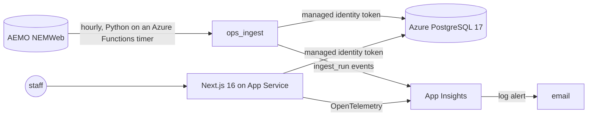

# AEMO DUID Network Constraint Forecast Demo

Solar and wind farms in Australia's National Electricity Market are regularly held back by
network constraints, and the people who operate them need to see it coming and see it
happen. This repository works on both halves with AEMO's public NEMWeb data.

The forecasting half answers a narrow but realistic question:

> For a given AEMO Dispatchable Unit ID (`DUID`), forecast the next 1–72 hours in which network-related generic constraints are likely to bind.

It uses AEMO public NEMWeb data for dispatch labels and constraint mapping, adds weather/time features, trains a small ML classifier, and exposes the result three ways: a queryable FastAPI endpoint, an MCP server an agent can call directly, and the risk card in the site ops console below.

---

## Site ops console

A staff console (`console/`) for managing customers, sites and DUIDs and watching each site's
operations, deployed on Azure: **https://siteops-console-coxh2t.azurewebsites.net** (staff
sign-in; accounts are created by an administrator).


*Real data: Cathedral Rocks (CATHROCK), trading day 2026-10-17. Shaded bands are intervals
where AEMO applied the semi-dispatch cap; the estimate puts the curtailed energy at
181.4 MWh across 120 capped intervals.*

- **Manage**: customers, sites and AEMO DUIDs with create, edit and archive.
  - Two roles, admin and viewer, from one permission table that every server-side data
    function checks.
  - Optimistic concurrency on edits.
  - An audit row written in the same transaction as each change.
  - A DUID can only be attached if it is in the AEMO registry and matches the site's
    region and fuel.
- **Watch**, per trading day:
  - actual output (SCADA) against available output (UIGF) and the dispatch target;
  - a curtailment estimate;
  - which forecast AEMO dispatch used (the participant's self-forecast or AWEFS/ASEFS),
    and how many submissions were suppressed;
  - the constraint-risk forecast from this repository's model.

  Every data source shows its age.
- **Data**: 12 real AEMO-registered solar and wind DUIDs across NSW, QLD, SA and VIC. All
  operational numbers are public NEMWeb data. **Customers are synthetic** and labelled so
  in the UI and the database.



| Area | What is used |
|---|---|
| App | Next.js 16 App Router, React 19, TypeScript, Tailwind, Recharts |
| Data | PostgreSQL 17, Prisma 7 (migrations own every table, including those the Python job writes) |
| Auth | Better Auth (email + password, no public sign-up), role-based access in `lib/rbac.ts` |
| Pipeline | Python on an hourly Azure Functions timer (Flex Consumption): a streaming reader for AEMO multi-table CSV zips, idempotent per-file loads |
| Tests | pytest, Vitest (unit and Postgres integration), Playwright against the production build |
| Delivery | GitHub Actions CI; deploy via OIDC (no Azure secret stored); Bicep for all infrastructure |
| Operations | App Insights, `/api/health`, `/api/ready` (data freshness), ingest-failure log alert |

**Measured** (details and sources in [docs/console-PLAN.md](docs/console-PLAN.md#11-progress-log)):

| | |
|---|---|
| Tests in CI | 125 pytest, 46 Vitest, 8 Playwright |
| Data on Azure after the first load | 105,384 SCADA readings, 103,680 dispatch intervals, 65,943 forecast-origin rows |
| Push to deployed and healthy | 6 min 26 s (build 48 s, migrate + deploy + smoke test 5 min 36 s) |
| SCADA vs dispatch `INITIALMW` cross-check | median absolute difference 0.0 MW over 100,224 intervals |
| Public endpoints from Melbourne, warm | `/api/health` p95 282 ms, `/api/ready` p95 491 ms |
| Signed-in site page from Melbourne, warm | p95 367 ms to first byte; server time + one round trip p95 168 ms |
| Hourly ingest on Azure Functions, first 9 runs | all succeeded; median 10.3 s; 39.7 s for the run that also loads the daily files |

**Security choices**:
- The database has **no password login**. The web app and the ingest function sign in
  with their managed identities and get data access only (no DDL). The function's storage
  account rejects shared-key access.
- GitHub Actions signs in to Azure with OIDC federation, scoped to one resource group, and
  to the database with an Entra token.
- The only secrets anywhere are the console accounts' passwords.

**Region**: New Zealand North. The Azure for Students subscription used here only allows
five regions, none of them in Australia, and this is the closest. The web app and database run
on free tiers: App Service F1, PostgreSQL B1MS under the 12-month free offer, Log Analytics
with a 0.1 GB/day cap. Two items are paid: the log alert rule (US$0.50/month) and the
ingest function on Flex Consumption (about US$1/month from the measured run times,
assuming its free grant does not cover this subscription).

Run it locally: [console/README.md](console/README.md). Deploy it: `infra/deploy.sh`, then
push.

<!-- ### Decisions: written by the repository author; uncomment the heading when it has content. -->

---

## Demo result

- Selected target: `CATHROCK`
- Selected horizon: `6h`
- Best model: `logistic_regression` with `time_weather_dispatch_lag` features
- Mean event-window AP: `0.615064`
- Mean precision@top 5%: `0.633333`
- Mean lift@top 5%: `1.944939`
- Mean ROC AUC: `0.618640`

Lead-time buckets (Phase 6) split that horizon into per-hour windows. They deliver a forward risk
curve, but every bucket scores far below the cumulative model — mean AP `0.09`–`0.17` against
`0.60`, with `lift@top-5%` below `1.0`. The model can say a constraint is coming; it cannot say
which hour.

This is a workflow demo, not a production forecast model. The event-window folds are sparse — the
60-day window contains only 3 binding events — the chronological holdout has no positive `CATHROCK`
6h labels, and P5MIN/Predispatch, outage, regional demand, and interconnector inputs are future
extensions.

---

## Why this maps to the internship brief

The internship brief asks for a service that can be queried for a `DUID` and return planned AEMO constraints plus ML-forecast constraints.

This demo implements a minimum viable version:

1. **AEMO public data ingestion**
   - Downloads AEMO standing-data tables from MMSDM monthly archives.
   - Downloads recent `Next Day Dispatch` public files instead of huge full-month dispatch tables.

2. **DUID → constraint mapping**
   - Maps `DUID -> CONNECTIONPOINTID` using `DUDETAIL`.
   - Maps `CONNECTIONPOINTID -> GENCONID` using `SPDCONNECTIONPOINTCONSTRAINT`.

3. **Historical label construction**
   - Uses `DISPATCHCONSTRAINT` rows for relevant `GENCONID`s.
   - Defines the target as `1` when any relevant constraint is binding or violating at a dispatch interval.
   - Phase 2 trains against a future-only horizon label for the selected DUID.

4. **ML forecast model**
   - Features: time-of-day, day-of-week, month, weekend flag, weather, and current-or-past dispatch lag signals.
   - Selected Phase 3 model: logistic regression for speed and explainability.

5. **Queryable service**
   - `GET /forecast/{duid}` returns ML probabilities and a lightweight planned/invoked-constraint view.
   - The same pipeline is exposed as four MCP tools, so an agent can query dispatch, constraints, and forecasts directly.

---

## Data sources

### AEMO/NEMWeb

- **MMSDM monthly archive root**: `https://www.nemweb.com.au/Data_Archive/Wholesale_Electricity/MMSDM/`
- **Current Next Day Dispatch rolling files**: `https://www.nemweb.com.au/Reports/CURRENT/Next_Day_Dispatch/`
- **AEMO Dispatch data description**: `Next Day Dispatch` contains unit dispatch and constraint solutions for each 5-minute dispatch run of the previous trading day.
- **AEMO table docs used**:
  - `DISPATCHCONSTRAINT`: binding/interregion constraints, RHS, LHS, marginal value, violation degree.
  - `DUDETAIL`: dispatchable unit detail, including connection-point mapping.
  - `SPDCONNECTIONPOINTCONSTRAINT`: connection-point LHS factors for generic constraints.
  - `GENCONSET`: generic constraint set membership.
  - `GENCONSETINVOKE`/`GENCONDATA`: constraint-set invocation and constraint metadata.

### Weather

- **Open-Meteo historical weather API**: `https://open-meteo.com/en/docs/historical-weather-api`
- **Open-Meteo forecast API**: `https://open-meteo.com/en/docs`

Open-Meteo is used only for a demo weather signal. A production version should use whichever weather/NWP feed the site operator prefers.

---

## Label definition

For a selected `DUID`, first identify the generic constraints that include the DUID's connection point on the LHS.

For dispatch interval `t`:

```text
target_constrained(t, DUID) = 1
if any relevant GENCONID has MARGINALVALUE > 0 or VIOLATIONDEGREE > 0 in DISPATCHCONSTRAINT
else 0
```

For a forecast horizon `H`, Phase 2 uses:

```text
target_constrained_next_Hh(t, DUID) = 1
if target_constrained is 1 in any future dispatch interval from t+1 through t+H
else 0
```

The current interval is excluded from the horizon label. Training drops the final incomplete horizon window instead of
turning unknown future intervals into false negatives.

This is intentionally simple and auditable. The real production version should refine the definition using AEMO constraint taxonomy, outage context, P5MIN/Predispatch constraint solution data, and domain-specific rules for network-vs-system constraints.

---

## Repository structure

```text
.
├── README.md
├── requirements.txt
├── requirements-ingest.txt      # pinned deps for the scheduled ingest job
├── docker-compose.yml           # local Postgres for the console and ingest
├── app.py
├── run_mcp_server.py
├── console/                     # Next.js site ops console (see console/README.md)
├── infra/                       # Bicep + deploy.sh + database role SQL for Azure
├── .github/workflows/           # ci.yml, deploy.yml, ingest.yml
├── data/
│   ├── console_duids.txt        # the console's 12 DUIDs
│   └── site_registry.csv        # AEMO registry rows for them (scripts/build_site_registry.py)
├── docs/
│   ├── console-PLAN.md          # console plan, acceptance targets and progress log
│   ├── console-METRICS.md       # measured numbers behind the README table
│   ├── images/                  # README screenshots
│   └── reports/                 # Phase 3 and Phase 6 run reports
├── notebooks/
│   └── aemo_constraint_forecast_demo.ipynb
├── scripts/
│   ├── benchmark_models.py
│   ├── backtest_horizon_model.py
│   ├── find_constrained_duids.py
│   ├── train_lead_time_models.py
│   ├── build_site_registry.py
│   └── ops_data_checks.py
├── tests/
│   ├── test_aemo_client.py
│   ├── test_api.py
│   ├── test_backtest.py
│   ├── test_benchmark_models.py
│   ├── test_features.py
│   ├── test_forecast.py
│   ├── test_frames.py
│   ├── test_lead_time_models.py
│   ├── test_mcp_server.py
│   ├── test_nemweb_stream.py
│   ├── test_notebook_readme.py
│   ├── test_ops_ingest.py
│   ├── test_site_registry.py
│   ├── test_train.py
│   └── test_weather.py
└── src/aemo_constraint_demo/
    ├── aemo_client.py       # NEMWeb download + AEMO CSV parsing
    ├── features.py          # DUID mapping, labels, time features
    ├── frames.py            # shared train/backtest/serve feature frame
    ├── weather.py           # Open-Meteo history/forecast helpers
    ├── train.py             # CLI model training
    ├── forecast.py          # model-bundle query logic
    ├── mcp_server.py        # MCP tools over the same pipeline
    ├── site_registry.py     # AEMO registry rows for the console's sites
    ├── nemweb_stream.py     # row-streaming reader for large AEMO zips
    └── ops_ingest.py        # NEMWeb → Postgres loader for the console
```

---

## Quick start

### 1. Create environment

```bash
python -m venv .venv
source .venv/bin/activate  # Windows: .venv\Scripts\activate
pip install -r requirements.txt
```

### 2. Use or regenerate the selected model

The final API example uses the small Phase 3 best-model bundle:

```text
artifacts/cathrock_6h_best_model.joblib
```

If that bundle is missing, regenerate it with the Phase 3 benchmark command in the performance section below. For a simpler training smoke test, run:

```bash
python -m src.aemo_constraint_demo.train \
  --duid CATHROCK \
  --days 60 \
  --horizon-hours 6 \
  --model-out artifacts/cathrock_6h.joblib
```

`CATHROCK` coordinates are read from `data/duid_coordinates.csv`. You can override them with `--lat` and `--lon`.
For a faster smoke test, reduce `--days`, or add `--no-weather` to skip Open-Meteo.

The script prints a JSON summary like:

```json
{
  "model_out": "artifacts/cathrock_6h.joblib",
  "metrics_out": "artifacts/cathrock_6h_metrics.json",
  "duid": "CATHROCK",
  "connection_point": "SCRK",
  "horizon_hours": 6,
  "target_column": "target_constrained_next_6h",
  "relevant_genconids_count": 103,
  "feature_columns": ["hour_sin", "hour_cos", "dow_sin", "dow_cos", "temperature_2m"],
  "metrics": {
    "model_type": "balanced_logistic_regression",
    "total_samples": 17208,
    "positive_rate": 0.013249651324965132,
    "average_precision": null,
    "roc_auc": null,
    "supplemental_positive_backtest": {
      "available": true,
      "average_precision": 0.4725645845784202,
      "roc_auc": 0.3285603715170279
    }
  }
}
```

The exact metrics depend on the chosen DUID, date window, and current NEMWeb rolling files.
If the training split has one target class, the script saves a `constant_probability_baseline` model instead of failing.
If the held-out set has one target class, `average_precision` and `roc_auc` are recorded as `null`.

### Phase 1: Target Discovery

Before training a meaningful classifier, scan candidate DUIDs and time windows to find targets with real positive
constraint labels:

```bash
python scripts/find_constrained_duids.py \
  --days 30 60 \
  --max-duids 50 \
  --out artifacts/duid_constraint_scan.csv \
  --verbose
```

The scan writes `artifacts/duid_constraint_scan.csv` and a ranked
`artifacts/duid_constraint_scan_top.csv`. Use `positive_intervals` and `positive_rate` to pick the next training
target: zero-positive DUIDs are useful smoke tests but will fall back to the constant baseline, while recommended rows
have enough sparse positives for a baseline ML classifier.

### Phase 1.5: Forecast-Horizon Target Discovery

The direct 5-minute binding label can be too sparse for a useful forecasting demo. Phase 1.5 keeps the auditable
current-interval label and adds future-only horizon labels:

```text
target_constrained_next_1h
target_constrained_next_3h
target_constrained_next_6h
```

Each horizon label is `1` when a relevant constraint binds in a future dispatch interval inside that window. The
current interval is excluded, so features for a row can remain current-or-past only.

Run the expanded scan:

```bash
python scripts/find_constrained_duids.py \
  --days 60 90 120 \
  --horizons-hours 1 3 6 \
  --max-duids 200 \
  --out artifacts/duid_constraint_scan_expanded.csv \
  --top-out artifacts/duid_constraint_scan_expanded_top.csv \
  --verbose
```

The scan writes one row per `DUID`/window/horizon. Pick the best model-training target from the ranked top CSV by
preferring rows where `recommended` is true, then higher `positive_intervals`, practical `positive_rate`, and recent
`last_positive_dispatch_interval`. Phase 2 trains against the selected horizon label with `--horizon-hours`.

### Phase 2: Horizon-Based ML Training

Phase 2 target:

```text
DUID: CATHROCK
connection_point_id: SCRK
days: 60
horizon_hours: 6
target: target_constrained_next_6h
```

The selected run generated:

```text
model_type: balanced_logistic_regression
total_samples: 17208
train_samples: 13766
test_samples: 3442
positive_rate: 0.013249651324965132
train_positive_rate: 0.016562545401714368
test_positive_rate: 0.0
average_precision: null
roc_auc: null
precision_at_top_5_percent: 0.0
```

The model is non-baseline. The chronological test window has no positive horizon events, so AP and ROC AUC are
reported as `null` rather than fabricated.

The trainer also records a supplemental positive held-out backtest. It chooses the latest 24-hour validation window
with positive labels and trains only on rows before that window:

```text
validation_start: 2026-04-22T22:20:00
validation_end: 2026-04-23T22:15:00
train_samples: 9723
train_positive_samples: 76
validation_samples: 288
validation_positive_samples: 152
validation_positive_rate: 0.5277777777777778
average_precision: 0.4725645845784202
roc_auc: 0.3285603715170279
precision_at_top_5_percent: 0.8
```

The positive-window AUC is weak, which is useful signal for the demo: time and weather features alone rank the event
window poorly, while the top 5% precision shows the fitted probabilities still concentrate some high-risk intervals.

Metrics and response artifacts:

```text
artifacts/cathrock_6h_metrics.json
artifacts/example_cathrock_6h_response.json
```

### Phase 2.5: Evaluation hardening

Phase 2.5 keeps the model story honest: this is a forecasting workflow demo, not a production-accurate constraint
forecaster. The normal chronological holdout contains no positive `CATHROCK` 6h horizon events, so AP and ROC AUC are
`null`. To still test ranking behavior around rare events, the repo includes event-window backtesting where each fold
trains only on rows strictly before the validation window.

Run:

```bash
python scripts/backtest_horizon_model.py \
  --duid CATHROCK \
  --days 60 \
  --horizon-hours 6 \
  --model-out artifacts/cathrock_6h.joblib \
  --out artifacts/cathrock_6h_backtest_summary.json \
  --folds-out artifacts/cathrock_6h_backtest_folds.csv \
  --max-folds 5
```

Observed Phase 2.5 backtest summary:

```text
evaluated_folds: 2
skipped_folds: 1
mean_average_precision: 0.4292536031939571
mean_roc_auc: 0.5348134028244604
mean_precision_at_top_5_percent: 0.43333333333333335
mean_lift_at_top_5_percent: 0.8856345408976989
```

These metrics should not be described as strong model performance. They show that the pipeline can be evaluated without
future leakage and that some event-window ranking signal exists, while top-5% lift below 1.0 means the model is not
consistently concentrating the rare positive intervals.

Backtest artifacts:

```text
artifacts/cathrock_6h_backtest_summary.json
artifacts/cathrock_6h_backtest_folds.csv
artifacts/example_cathrock_6h_backtest_response.json
```

### Phase 3: Performance Improvement

Phase 3 adds leakage-guarded feature sets, model benchmarking, and a best-model bundle for the same `CATHROCK` 60-day
6h horizon target.

Run:

```bash
python scripts/benchmark_models.py \
  --duid CATHROCK \
  --days 60 \
  --horizon-hours 6 \
  --feature-sets time_only time_weather time_weather_dispatch_lag time_weather_constraint_lag \
  --model-types logistic_regression random_forest hist_gradient_boosting \
  --out artifacts/performance_benchmark.csv \
  --best-model-out artifacts/cathrock_6h_best_model.joblib \
  --report-out docs/reports/phase3_performance_report.md
```

Observed best setting:

```text
model: logistic_regression
feature_set: time_weather_dispatch_lag
evaluated_folds: 2
skipped_folds: 1
mean_average_precision: 0.6150641656145446
mean_roc_auc: 0.6186397911557198
mean_precision_at_top_5_percent: 0.6333333333333333
mean_lift_at_top_5_percent: 1.9449390521758945
```

Compared with the Phase 2.5 event-window AP of `0.4292536031939571`, the dispatch-lag feature set improved ranking in
this sparse-event backtest. This is still not a production accuracy claim: the normal chronological holdout has no
positive labels, event-window folds are few, and P5MIN/Predispatch, outage, regional demand, and interconnector inputs
remain outside this demo.

Phase 3 artifacts:

```text
artifacts/performance_benchmark.csv
artifacts/cathrock_6h_best_model.joblib
artifacts/cathrock_6h_best_model_metrics.json
artifacts/cathrock_6h_feature_importance.csv
docs/reports/phase3_performance_report.md
```

### Phase 5: Forecast-time feature parity

Phase 5 fixes a train/serve skew, not the model.

Training builds one row per dispatch interval `t` — time features at `t`, weather at `t`, dispatch lags from strictly
before `t` — and labels it "does a relevant constraint bind in `(t, t+6h]`". That is an origin-anchored forecasting
setup, and the Phase 3 event-window metrics were measured against exactly that frame.

Serving did something else. It generated 72 *future* 5-minute intervals and scored each as its own row. Dispatch lag
features cannot exist for a future interval, so 36 of the selected bundle's 50 features were quietly filled with training
medians, and the output was labelled as a per-interval probability — which is not what any of those rows meant.

Replaying the committed bundle over cached NEMWeb data around a real binding event:

```text
origin 2026-04-22 06:00, constraint actually bound at 06:20

old serving path (36/50 features imputed):   p = 0.0003
same bundle, features as training built them: p = 0.807
```

The fix has three parts:

1. `src/aemo_constraint_demo/frames.py` — one `build_model_frame` shared by training, backtesting, and serving. All three
   previously carried their own copy of the pipeline, which is how the paths drifted apart.
2. `forecast_from_bundle` is now origin-anchored: it loads recent dispatch, scores the **latest observed** interval, and
   returns the single probability the model actually estimates, plus `as_of`, `data_lag_hours`, the invoked-constraint
   timeline, and a 24-hour risk trajectory.
3. `tests/test_frames.py` asserts that the training frame and the serving frame produce identical feature values for the
   same origin. That test is the reason the skew cannot come back silently.

What this does **not** claim. The numbers above are partly in-sample — the bundle trained on a window containing April —
so they demonstrate that the serving path was discarding the model, not that the model is accurate. The out-of-sample
claim is unchanged from Phase 3 (mean event-window AP `0.615`, lift@top-5% `1.94`), because `backtest_horizon_model.py`
always used the correct frame. Two honest caveats remain: probabilities are close to saturated (typically `<1e-15` or
`>0.9`), so treat them as a ranking signal rather than calibrated risk; and the origin trails real time by 4–28 hours
because Next Day Dispatch publishes the previous trading day.

### Phase 6: Lead-time buckets

Phase 5 left one probability for the whole horizon, which cannot say *when* inside the window
the risk sits. Phase 6 adds disjoint lead-time buckets that tile the horizon:

```text
target_constrained_lead_Xh(t) = 1 if a relevant constraint binds in (t+(X-1)h, t+Xh]
```

One model per bucket, all scored from the same origin with the same origin-anchored features, so
a single call produces a forward curve without inventing feature values for future intervals. The
bucket configuration reuses the Phase 3 winner rather than re-running the whole feature-set
benchmark.

```bash
python scripts/train_lead_time_models.py \
  --duid CATHROCK --days 60 --horizon-hours 6 --lead-hours 1 2 3 4 5 6 \
  --source cache --end-date 2026-05-18 \
  --feature-set time_weather_dispatch_lag --model-type logistic_regression \
  --model-out artifacts/cathrock_lead_time_models.joblib \
  --metrics-out artifacts/cathrock_lead_time_metrics.json \
  --folds-out artifacts/cathrock_lead_time_folds.csv \
  --report-out docs/reports/phase6_lead_time_report.md
```

Query it the same way as any other bundle; the response gains `risk_curve` and `peak_lead`:

```bash
curl "http://127.0.0.1:8000/forecast/CATHROCK?model_path=artifacts/cathrock_lead_time_models.joblib&source=cache"
```

#### Result: the model knows *whether*, not *when*

| Target | Positives | Folds | Mean AP | Mean ROC AUC | Mean lift@top-5% |
| --- | --- | --- | --- | --- | --- |
| Cumulative `next_6h` | 228 | 2 | `0.6048` | `0.6085` | `1.8182` |
| Bucket `lead_1h` | 48 | 2 | `0.1276` | `0.5699` | `0.5667` |
| Bucket `lead_2h` | 48 | 2 | `0.1664` | `0.5350` | `0.5667` |
| Bucket `lead_3h` | 48 | 2 | `0.0943` | `0.3747` | `0.5667` |
| Bucket `lead_4h` | 48 | 2 | `0.1519` | `0.6248` | `0.5667` |
| Bucket `lead_5h` | 48 | 2 | `0.1370` | `0.6554` | `0.5667` |
| Bucket `lead_6h` | 48 | 2 | `0.1514` | `0.6776` | `0.5667` |

Every bucket scores far below the cumulative model, and `lift@top-5%` under `1.0` means the
highest-scoring intervals contain *fewer* events than a random slice would. Serving a replay makes
the same point visually — anchored at `2026-04-23 04:00`, ahead of a constraint that really bound at
06:20:

```text
lead 1h  04:00–05:00  p=0.8645  high
lead 2h  05:00–06:00  p=0.9801  high
lead 3h  06:00–07:00  p=0.9918  high   <- the window the event actually fell in
lead 4h  07:00–08:00  p=0.9948  high   <- the curve's peak
lead 5h  08:00–09:00  p=0.9836  high
lead 6h  09:00–10:00  p=0.2804  medium
```

The curve is high across almost the whole horizon and peaks one bucket late. That is the honest
finding: dispatch-lag features carry "conditions are constraint-prone", not "at hour k". Two causes
are visible in the data and neither is fixable by better modelling alone — the 60-day window
contains only **3 binding events** (14 dispatch intervals, all near 06:00 or 22:00), and bucket
labels are 5x sparser than the cumulative label by construction. Only 2 of 3 candidate folds are
evaluable, because nothing before the earliest event gives a two-class training split.

The identical `0.5667` across buckets is small-sample quantisation, not a bug: top-5% of a 289-row
window is ~15 rows, and every bucket lands exactly one true positive there. The per-bucket AP and
ROC AUC do differ, and the fitted coefficients differ too.

So the forward curve is delivered and structurally sound, but it should be read as *shape*, not as a
calibrated timing forecast. Resolving timing needs the inputs a production build would have —
P5MIN/Predispatch constraint solutions, outage schedules, and far more events than three.

Phase 6 artifacts:

```text
artifacts/cathrock_lead_time_models.joblib
artifacts/cathrock_lead_time_metrics.json
artifacts/cathrock_lead_time_folds.csv
docs/reports/phase6_lead_time_report.md
```

### 3. Run tests

The test suite is offline and uses synthetic AEMO-style ZIP payloads, mocked HTTP calls, and small in-memory training data.

```bash
python -m pytest
```

Coverage focus:

- notebook structure and cleared outputs;
- NEMWeb URL/download helpers and AEMO ZIP/table parsing;
- `DUID -> CONNECTIONPOINTID -> GENCONID` mapping and label construction;
- weather merge helpers;
- baseline ML training bundle creation;
- event-window backtest fold selection and safe rare-event metrics;
- train/serve feature parity for a shared forecast origin;
- lead-time bucket labels tiling the horizon without overlap;
- forecast helper logic and FastAPI response/error paths;
- MCP tool contracts, cache-first NEMWeb loading, and error messages.

### 4. Run query service

```bash
uvicorn app:app --reload
```

Forecast query:

```bash
curl "http://127.0.0.1:8000/forecast/CATHROCK?model_path=artifacts/cathrock_6h_best_model.joblib&source=network"
```

Offline-safe demo forecast, answered from previously downloaded NEMWeb files:

```bash
curl "http://127.0.0.1:8000/forecast/CATHROCK?model_path=artifacts/cathrock_6h_best_model.joblib&source=cache&use_weather=false"
```

Replay a historical origin, which is how the demo is checked against a known binding event:

```bash
curl "http://127.0.0.1:8000/forecast/CATHROCK?model_path=artifacts/cathrock_6h_best_model.joblib&source=cache&end_date=2026-04-22"
```

The API infers `horizon_hours=6` from the model bundle when the query parameter is omitted; an explicit horizon that
mismatches the bundle returns a clear `400` instead of silently serving the wrong one.

The answer is **origin-anchored**: one probability for the horizon starting at the latest dispatch interval NEMWeb has
published. `as_of` and `data_lag_hours` say how stale that origin is — Next Day Dispatch publishes the previous trading
day, so nothing here is live. `feature_coverage` reports how much of the model's input was actually observed rather than
imputed; a non-zero `imputed` count means the probability rests on incomplete inputs.

Example response shape (trimmed; the full artifact is `artifacts/example_cathrock_6h_response.json`):

```json
{
  "duid": "CATHROCK",
  "connection_point": "SCRK",
  "horizon_hours": 6,
  "as_of": "2026-08-29T04:00:00",
  "horizon_end": "2026-08-29T10:00:00",
  "data_lag_hours": 9.19,
  "constraint_risk": {
    "probability": 0.0,
    "risk_level": "very_low",
    "statement": "P(a relevant generic constraint binds for CATHROCK between 2026-08-29T04:00:00 and 2026-08-29T10:00:00)"
  },
  "feature_coverage": {"required": 50, "observed": 50, "imputed": 0, "imputed_examples": []},
  "dispatch_source": {
    "source": "network",
    "history_days": 2,
    "first_interval": "2026-08-27T04:05:00",
    "last_interval": "2026-08-29T04:00:00",
    "interval_count": 576
  },
  "weather_source": "open_meteo_history",
  "model": {
    "model_type": "logistic_regression",
    "feature_set": "time_weather_dispatch_lag",
    "target_column": "target_constrained_next_6h",
    "positive_rate": 0.013249651324965132
  },
  "relevant_genconids_count": 103,
  "planned_constraints": [],
  "recent_risk_history": [
    {"origin": "2026-08-29T03:00:00", "probability": 0.0, "risk_level": "very_low"}
  ]
}
```

---

## MCP server

The same pipeline is also packaged as an [MCP](https://modelcontextprotocol.io) server, so an
agent can query NEMWeb directly instead of going through the REST endpoint. Four read-only
tools cover the whole demo workflow: pick a target, inspect its dispatch, inspect its
constraints, run the forecast.


*Session captured with `claude -p`, rendered from the transcript.*

### Install

From the repository root, with the virtualenv created and `requirements.txt` installed:

```bash
claude mcp add aemo-nemweb -- "$PWD/.venv/bin/python" "$PWD/run_mcp_server.py"
```

Check it with `claude mcp list`; remove it with `claude mcp remove aemo-nemweb`.

For any other MCP client, the equivalent stdio config is:

```json
{
  "mcpServers": {
    "aemo-nemweb": {
      "command": "/abs/path/to/aemo-network-constraint-demo/.venv/bin/python",
      "args": ["/abs/path/to/aemo-network-constraint-demo/run_mcp_server.py"]
    }
  }
}
```

`run_mcp_server.py` resolves data, artifact, and model paths against the repository root, so
the client can launch it from any working directory.

### Tools

| Tool | Answers | Key arguments |
| --- | --- | --- |
| `aemo_list_duid_targets` | Which DUIDs have usable constraint labels, and which model bundles exist | `horizon_hours`, `recommended_only`, `limit` |
| `aemo_get_duid_dispatch` | 5-minute cleared MW / availability history for a DUID | `duid`, `days`, `source`, `end_date`, `max_intervals` |
| `aemo_get_duid_constraints` | The DUID's relevant `GENCONID`s, and which of them actually bound | `duid`, `days`, `source`, `include_binding_history`, `top_n` |
| `aemo_forecast_duid_constraints` | Probability that a constraint binds over the next horizon, anchored at the latest observed interval — plus a per-hour forward curve when given a lead-time bundle | `duid`, `model_path`, `horizon_hours`, `history_days`, `source`, `end_date` |

`aemo_list_duid_targets` reads the committed scan artifacts and never touches the network.
The other three accept a `source` argument:

- `cache` — use previously downloaded NEMWeb files only;
- `network` — always fetch from NEMWeb (roughly 3–5 seconds per trading day);
- `auto` (default) — use the cache when it already covers the requested window.

Parsed trading days are cached in-process, so repeated queries over the same window are fast.
`data/cache/` is gitignored, so a fresh clone starts with an empty cache and `auto` will
download.

### Example prompts

```text
Which DUIDs in this demo have enough binding-constraint history to train on?
Show CATHROCK's dispatch for the last 2 trading days.
Which of CATHROCK's constraints bound on 22-23 April 2026?
What is CATHROCK's constraint risk for the next 6 hours, and how stale is the input data?
Replay CATHROCK's 22 April 2026 forecast and compare it against what actually bound.
```

### Design notes

- **One question, one answer.** The model estimates "will a relevant constraint bind in the next
  `horizon_hours`, given the state now", so the tool returns one probability rather than a per-interval
  curve it was never trained to produce. See Phase 5 above for the skew this replaced.
- **Staleness is stated, not implied.** NEMWeb publishes Next Day Dispatch for the previous trading
  day, so the answer is anchored at the latest published interval and carries `as_of` and
  `data_lag_hours`. The server instructions tell the agent to quote them.
- **Inputs are audited.** `feature_coverage` reports how many of the model's features were actually
  observed at the origin versus imputed. `imputed: 0` is the healthy case; anything else means the
  probability rests on incomplete inputs, and the tool says so rather than presenting a
  confident-looking number.
- **Actionable errors.** An unknown DUID, a missing bundle, or a horizon that disagrees with the
  bundle returns a message naming the fix and the tool to call next, not a stack trace.
- **Context budget.** Long series are downsampled evenly (keeping the first and last interval) and
  summarised — the 24-hour risk trajectory comes back hourly, and the invoked-constraint timeline is
  aggregated per constraint rather than per five-minute row.

### Run the server directly

```bash
python run_mcp_server.py            # stdio, for a client to attach to
python -m pytest tests/test_mcp_server.py
```

---

## Notebook path

Open:

```bash
jupyter notebook notebooks/aemo_constraint_forecast_demo.ipynb
```

The notebook walks through:

1. Target discovery and why `CATHROCK` was selected.
2. `DUID -> CONNECTIONPOINTID -> GENCONID` mapping.
3. Future-only `target_constrained_next_6h` label definition.
4. Training command and model metrics.
5. Event-window backtest summary.
6. API query examples with inferred and explicit horizon.
7. Limitations.

---

## Design choices

### Why Next Day Dispatch files?

Full MMSDM monthly dispatch tables can be hundreds of MB per table. For an internship demo, recent Next Day Dispatch files are a cleaner choice: they are small daily ZIPs and still include 5-minute unit dispatch plus constraint solutions for the previous trading day.

### Why logistic regression?

The first goal is a credible demo, not peak predictive performance. Balanced logistic regression is:

- fast;
- stable on small windows;
- explainable;
- easy to compare against a baseline.

A production extension can swap in gradient boosting, temporal convolution, sequence models, or quantile/probabilistic forecasting.

### What does “planned” mean here?

The service includes a lightweight planned/invoked view from `GENCONSET`, `GENCONSETINVOKE`, and `GENCONDATA`. This identifies relevant constraint sets active over future intervals where available. It is not a full P5MIN/Predispatch forecast-solution integration.

For a stronger production version, add:

- `P5MIN_CONSTRAINTSOLUTION` for near-term 5-minute forecast solutions;
- `PREDISPATCHCONSTRAINT` or new predispatch equivalent for longer-horizon forecast solutions;
- constraint-set outage descriptions and limit type metadata.

---

## Known limitations

1. **Network-vs-system classification is simplified.** This demo treats DUID-relevant generic constraints as the target class. A production build should classify network constraints more carefully.

2. **Geospatial metadata is tiny.**
   Phase 2 includes a vetted `CATHROCK` row in `data/duid_coordinates.csv`; production should maintain a complete
   DUID/station geospatial lookup.

3. **One model per DUID.** The service is intentionally narrow. Multi-DUID modelling would use a shared feature store and add DUID embeddings or categorical features.

4. **Short training window.** Recent rolling files are enough for a demo. Production should use long historical windows, outage context, seasonality, and backtesting.

5. **Forecast features are minimal.** Default query-time features are time and weather. Production should add AEMO forecast demand, regional/interconnector forecasts, UIGF, outage schedules, and P5MIN/Predispatch inputs.

6. **Evaluation remains sparse-event limited.**
   The chronological holdout has no positive `CATHROCK` 6h labels. Event-window folds are a transparent supplement, not
   proof of production-grade predictive accuracy.

---

## Suggested GitHub pitch

> Built a small AEMO public-data forecasting demo for DUID-level network constraint risk in the NEM. The system maps a generator DUID to relevant generic constraints, constructs labels from dispatch constraint outcomes, adds weather/time features, trains an interpretable ML classifier, and exposes a FastAPI endpoint returning planned/invoked constraints plus ML risk forecasts.

---

## Next production extensions

- Add P5MIN and Predispatch forecast-constraint solution ingestion.
- Add constraint taxonomy: thermal, voltage stability, transient stability, system strength, FCAS.
- Add long-run historical backtesting and grouped time-series cross-validation.
- Add DUID geospatial metadata and weather-grid matching.
- Add calibrated probabilities and threshold tuning by business objective.
- Revisit lead-time buckets once far more than 3 binding events are available, with P5MIN/Predispatch
  constraint solutions to carry the timing signal the dispatch-lag features do not.
- Add monitoring for data freshness, AEMO schema changes, and model drift.
