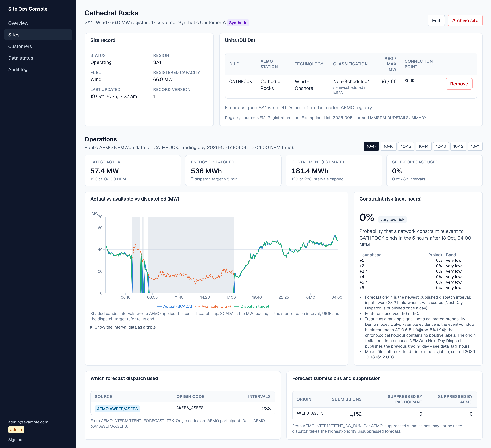
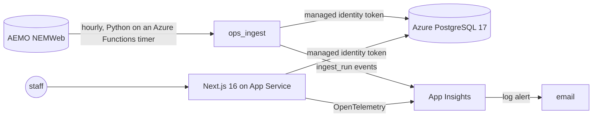
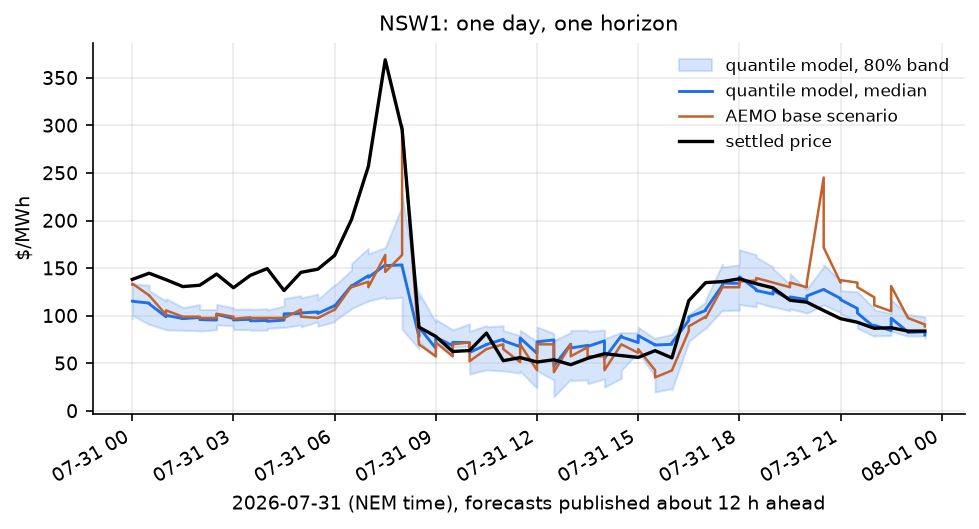
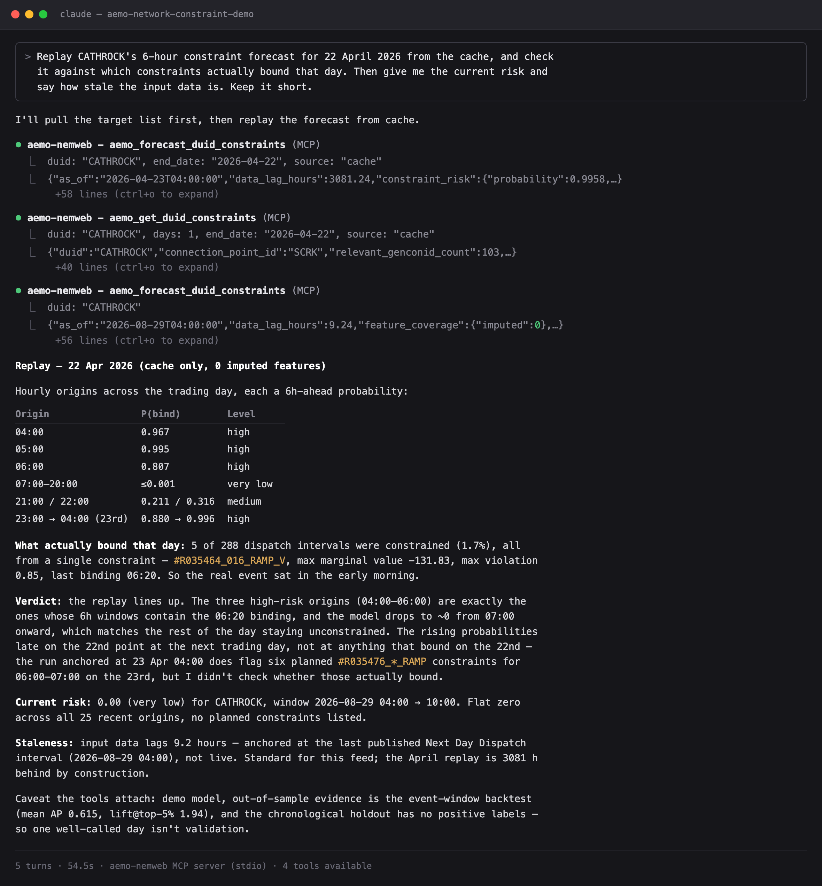

# NEM Site Ops Console

A staff console for looking after solar and wind farm customers in Australia's National
Electricity Market: manage customers, sites and their AEMO units, and watch each site's
operations on AEMO's public NEMWeb data. It is deployed on Azure:
**https://siteops-console-coxh2t.azurewebsites.net** (staff sign-in; accounts are created by
an administrator). The app runs on App Service's free F1 tier, which unloads it after about
20 idle minutes; a timer in the ingest function app pings it every 10 minutes to keep it
loaded. If a ping is missed, the first request can take up to about a minute.

A staff member's path through it:

1. **Manage** customers and sites, and attach each site's AEMO units (DUIDs).
2. **Watch** a site's trading day: actual output against available output and the dispatch
   target, the curtailment that follows, and which forecast AEMO dispatch used.
3. **Spot** stale data: every source shows its age, a site whose SCADA has stopped is
   flagged on its own, and a forecast whose window has ended says so.
4. **Change** records safely: roles are checked on the server, a stale form cannot overwrite
   a newer edit, a site's region and fuel must match its units, and every change writes an
   audit row in the same transaction.

A [sandbox mode](#sandbox-simulator) runs the same console on simulated farms calibrated on
these DUIDs. It is used to test the console against scripted situations (a network
constraint, a silent SCADA feed, a suppressed self-forecast, a failed load) and to train
staff on it.

The repository also holds two forecasting pieces built on the same NEMWeb data:

- [Constraint forecasting](#constraint-forecasting): the model behind the console's risk card.
- [Probabilistic price forecasting](#probabilistic-price-forecasting): how uncertain the next
  day and a half of prices is, as a range rather than a number, scored against AEMO's own
  published scenarios.

---

## Site ops console

The console lives in `console/`.



*Real data: Cathedral Rocks (CATHROCK), trading day 2026-10-17. Shaded bands are intervals
where AEMO applied the semi-dispatch cap; the estimate puts the curtailed energy at
181.4 MWh across 120 capped intervals.*

- **Manage**: customers, sites and AEMO DUIDs with create, edit and archive.
  - Two roles, admin and viewer, from one permission table that every server-side data
    function checks.
  - Optimistic concurrency on edits.
  - An audit row written in the same transaction as each change.
  - A DUID can only be attached if it is in the AEMO registry and matches the site's
    region and fuel, and a site's region or fuel cannot be edited away from its units'.
- **Watch**, per trading day:
  - actual output (SCADA) against available output (UIGF) and the dispatch target;
  - a curtailment estimate;
  - which forecast AEMO dispatch used (the participant's self-forecast or AWEFS/ASEFS),
    and how many submissions were suppressed;
  - the constraint-risk forecast from this repository's model, marked as ended once its
    window has passed (Next Day Dispatch arrives a day late, so it usually has).

  Every data source shows its age.
- **Data**: 12 real AEMO-registered solar and wind DUIDs across NSW, QLD, SA and VIC. All
  operational numbers are public NEMWeb data. **Customers are synthetic** and labelled so
  in the UI and the database.



| Area | What is used |
|---|---|
| App | Next.js 16 App Router, React 19, TypeScript, Tailwind, Recharts |
| Data | PostgreSQL 17, Prisma 7 (migrations own every table, including those the Python job writes) |
| Auth | Better Auth (email + password, no public sign-up), role-based access in `lib/rbac.ts` |
| Pipeline | Python on an hourly Azure Functions timer (Flex Consumption): a streaming reader for AEMO multi-table CSV zips, idempotent per-file loads |
| Tests | pytest, Vitest (unit and Postgres integration), Playwright against the production build |
| Delivery | GitHub Actions CI; deploy via OIDC (no Azure secret stored); Bicep for all infrastructure |
| Operations | App Insights, `/api/health`, `/api/ready` (data freshness), ingest-failure log alert, a 10-minute keep-warm ping from the function app |

**Measured** (details and sources in [docs/console-PLAN.md](docs/console-PLAN.md#11-progress-log)):

| | |
|---|---|
| Tests in CI | 253 pytest, 58 Vitest, 14 Playwright (5 of them on the sandbox) |
| Data on Azure after the first load | 105,384 SCADA readings, 103,680 dispatch intervals, 65,943 forecast-origin rows |
| Push to deployed and healthy | 6 min 26 s (build 48 s, migrate + deploy + smoke test 5 min 36 s) |
| SCADA vs dispatch `INITIALMW` cross-check | median absolute difference 0.0 MW over 100,224 intervals |
| Public endpoints from Melbourne, warm | `/api/health` p95 282 ms, `/api/ready` p95 491 ms |
| Signed-in site page from Melbourne, warm | p95 367 ms to first byte; server time + one round trip p95 168 ms |
| Hourly ingest on Azure Functions, first 9 runs | all succeeded; median 10.3 s; 39.7 s for the run that also loads the daily files |

**Security choices**:
- The database has **no password login**. The web app and the ingest function sign in
  with their managed identities and get data access only (no DDL). The function's storage
  account rejects shared-key access.
- GitHub Actions signs in to Azure with OIDC federation, scoped to one resource group, and
  to the database with an Entra token.
- The only secrets anywhere are the console accounts' passwords.

**Region**: New Zealand North. The Azure for Students subscription used here only allows
five regions, none of them in Australia, and this is the closest. The web app and database run
on free tiers: App Service F1, PostgreSQL B1MS under the 12-month free offer, Log Analytics
with a 0.1 GB/day cap. Two items are paid: the log alert rule (US$0.50/month) and the
ingest function on Flex Consumption (about US$1/month from the measured run times,
assuming its free grant does not cover this subscription).

Run it locally: [console/README.md](console/README.md). Deploy it: `infra/deploy.sh`, then
push.

<!-- ### Decisions: written by the repository author; uncomment the heading when it has content. -->

---

## Sandbox simulator

The sandbox is the console build above with `CONSOLE_SANDBOX=1`, on its own database, which
a simulator fills with solar and wind farms that behave like the real ones. The farms are
calibrated on the 12 real DUIDs, and a realism report checks the simulated fleet against
the real one. All 16 checks pass: output distribution, daily shape, 5-minute ramps, cap and
curtailment shares, tracking, and forecast source.

- **Scenarios**: a world file scripts events relative to the time it is loaded. In the
  training world, a ten-hour network constraint holds a wind farm back, a solar farm's
  SCADA stops, AEMO suppresses a farm's self-forecasts, and the latest SCADA load fails.
  Rows appear on NEMWeb's cadence: SCADA every 5 minutes, Next Day files 12 and 20 minutes
  after the trading day ends.
- **Testing**: Playwright checks that each scenario shows where it should. The SCADA outage
  found a gap: the fleet-wide freshness check stayed green while one farm was silent for
  three hours. The console now flags each site against the same 2-hour limit.
- **Training**: a Training page asks staff to find each scenario in the console and checks
  their answers on the server. The answers are read from the data the simulator wrote, so
  they always match the screen.
- **Safety**: the simulator refuses any database whose name does not end in `_sandbox` or
  `_e2e`.

Design, results and limits: [docs/simulation.md](docs/simulation.md).

---

## Constraint forecasting

How likely is a network constraint to bind on a given generator in the next few hours? The
pipeline maps the unit to its generic constraints (`DUID -> CONNECTIONPOINTID -> GENCONID`,
from `DUDETAIL` and `SPDCONNECTIONPOINTCONSTRAINT`), labels each 5-minute interval from
`DISPATCHCONSTRAINT`, adds time, weather and dispatch-lag features, and trains a logistic
regression. It is served by `GET /forecast/{duid}` (FastAPI), by the MCP server below, and as
the console's risk card. The shipped model covers one unit, Cathedral Rocks (`CATHROCK`).

| `CATHROCK`, 6-hour horizon, 2 event-window folds | Mean AP | Mean ROC AUC | Mean lift at top 5% |
|---|---|---|---|
| Will a constraint bind in the next 6 hours? | 0.605 | 0.609 | 1.82 |
| In which hour? (six one-hour models, range) | 0.09–0.17 | 0.37–0.68 | 0.57 |

- The model can tell that a constraint is coming, but not in which hour: at the top 5%, every
  one-hour model catches fewer events than a random slice would.
- The evidence is thin. The 60-day window holds 3 binding events, the chronological holdout
  has no positives, and the numbers above come from 2 event-window folds.
- Serving once scored future intervals with 36 of 50 features imputed. One frame builder now
  serves training, backtests and the API, and a test holds them to identical features.
- Next Day Dispatch publishes the previous trading day, so a forecast's origin trails real
  time by 4–28 hours.

Label definition, every run with its commands, and the limitations:
**[docs/constraint-forecasting.md](docs/constraint-forecasting.md)**.

---

## Probabilistic price forecasting

Every half hour AEMO publishes, for each region and each period out to about 39 hours, the
price under 43 demand scenarios. That is a public statement of how uncertain the next day
and a half of prices is, updated 48 times a day. Is it any good, and can it be beaten?

A year of data — 525,600 five-minute prices and 4.85 million scenario rows — answers it over
six rolling-origin folds, 485,830 scored forecasts per region. Four forecasts are written as
the same seven quantiles and scored the same way: AEMO's scenarios as published, those
scenarios recentred on their base case, persistence widened by its own error, and a
gradient-boosted quantile model.

| NSW1, Apr–Sep 2026 | CRPS | MAE | Median abs error | Bias | 80% interval covers |
|---|---|---|---|---|---|
| AEMO scenarios | 31.37 | 51.06 | 11.45 | +34.24 | 0.554 |
| Persistence | 20.74 | 33.20 | 24.37 | −0.44 | 0.895 |
| Quantile model | **8.14** | **13.17** | **9.38** | +0.44 | 0.649 |



- The published scenarios are **biased high by $34/MWh** and far too narrow: the range
  between their 25th and 75th percentiles holds the settled price 15% of the time.
- They are still **the model's most valuable feature**. Dropping the base scenario and the
  15 scenario-shape features costs 54% of the model's CRPS, uniformly across horizons.
- The model halves the error and removes the bias, but its 80% interval covers 65%, and in
  SA1's volatile hours its CRPS is 82 against 21 in normal conditions. On 31 July neither it
  nor AEMO saw the morning spike above $370.
- Adaptive selection between the four lands within 0.9% of the best single forecast without
  being told which one that is; inverse-loss weighting trades sharpness for the best
  calibration of any forecast here except persistence.
- A rolling **conformal recalibration**, read from the model's own settled residuals, then
  makes its intervals mean what they say: 80% coverage goes from 0.65 to 0.79 and 50% from
  0.38 to 0.49, for −2% of CRPS in NSW1 and +0.6% in SA1, refitting nothing.

Full write-up: **[docs/price-forecasting.md](docs/price-forecasting.md)**. The data layer,
including why the monthly archive cannot answer this question:
[docs/price-lane-data.md](docs/price-lane-data.md).

```bash
python -m src.aemo_constraint_demo.price_ingest --from 2025-10 --to 2026-09 --raw-regions NSW1,SA1
python scripts/price_data_checks.py --out artifacts/price_data_checks.json
python -m src.aemo_constraint_demo.price_dataset --region NSW1
python scripts/price_backtest.py --region NSW1 --predictions-out data/price/backtest_predictions_NSW1.csv.gz
python scripts/price_ensemble_backtest.py --region NSW1
python scripts/price_conformal_backtest.py --region NSW1
python scripts/price_figures.py --region NSW1
```

---

## MCP server

The same pipeline is packaged as an [MCP](https://modelcontextprotocol.io) server with four
read-only tools, so an agent can query NEMWeb and the model directly.



*Session captured with `claude -p`, rendered from the transcript.*

From the repository root, with the Python environment below set up:

```bash
claude mcp add aemo-nemweb -- "$PWD/.venv/bin/python" "$PWD/run_mcp_server.py"
```

| Tool | Answers | Key arguments |
| --- | --- | --- |
| `aemo_list_duid_targets` | Which DUIDs have usable constraint labels, and which model bundles exist | `horizon_hours`, `recommended_only`, `limit` |
| `aemo_get_duid_dispatch` | 5-minute cleared MW / availability history for a DUID | `duid`, `days`, `source`, `end_date`, `max_intervals` |
| `aemo_get_duid_constraints` | The DUID's relevant `GENCONID`s, and which of them actually bound | `duid`, `days`, `source`, `include_binding_history`, `top_n` |
| `aemo_forecast_duid_constraints` | Probability that a constraint binds over the next horizon, from the latest observed interval | `duid`, `model_path`, `horizon_hours`, `history_days`, `source`, `end_date` |

Config for other MCP clients, cache modes and design notes are in
[docs/constraint-forecasting.md](docs/constraint-forecasting.md#mcp-server).

---

## Run it

```bash
python -m venv .venv
source .venv/bin/activate  # Windows: .venv\Scripts\activate
pip install -r requirements.txt
python -m pytest           # offline; the ingest tests also use Postgres if TEST_DATABASE_URL is set
uvicorn app:app --reload
curl "http://127.0.0.1:8000/forecast/CATHROCK?model_path=artifacts/cathrock_6h_best_model.joblib&source=network"
```

- The console: [console/README.md](console/README.md).
- Training, backtests and historical replays:
  [docs/constraint-forecasting.md](docs/constraint-forecasting.md#runs).
- Price forecasting: the commands in [its section](#probabilistic-price-forecasting).
- The sandbox: [docs/simulation.md](docs/simulation.md#run-it).

## Repository layout

```text
console/                   Next.js site ops console
functions/                 Azure Functions app: hourly NEMWeb ingest, console keep-warm ping
infra/                     Bicep, deploy.sh, database role SQL
src/aemo_constraint_demo/  Python: NEMWeb reader and ingest, constraint model, price forecasting, sandbox simulator
app.py                     FastAPI forecast service
run_mcp_server.py          MCP server
scripts/                   target scans, training, backtests, data checks, figures
tests/                     pytest suite
notebooks/                 constraint-forecasting walkthrough
docs/                      console plan and metrics, forecasting and simulator write-ups, run reports
artifacts/                 committed model bundles, metrics and scan results
data/                      the console's DUIDs, their registry rows, unit coordinates, sandbox worlds (sim/)
docker-compose.yml         local Postgres for the console and ingest
.github/workflows/         ci.yml, deploy.yml, ingest.yml
```
