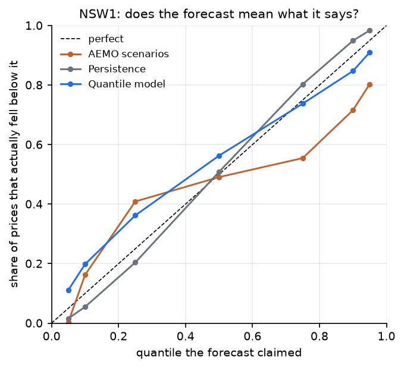
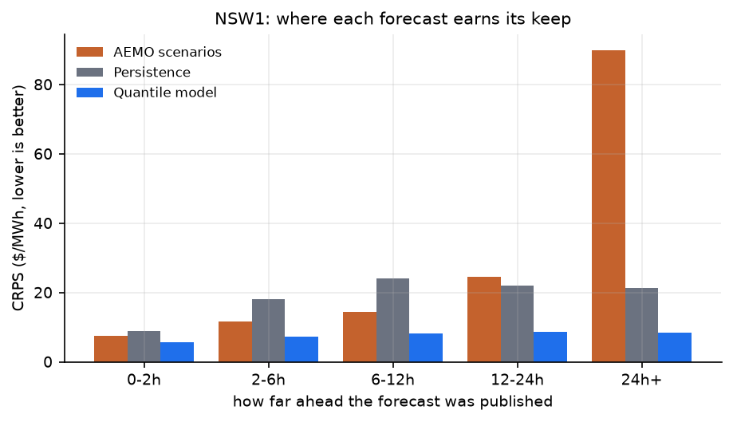

# Probabilistic price forecasting in the NEM

A dispatch price in the National Electricity Market is mostly boring and occasionally
extraordinary: in the year studied here New South Wales settled at a median of $71/MWh,
went negative 9.6% of the time and above $300/MWh in roughly one interval in 370. A single
number cannot describe that, so the question this lane answers is not "what will the price
be" but **"what range will the price be in, and how much should anyone believe that
range"**.

AEMO already publishes an answer. Every half hour its predispatch run reports, for each
region and each half-hourly period out to about 39 hours, the price under 43 demand
scenarios. That is a published statement of price uncertainty, updated 48 times a day, and
the first question here is how good it is.

- The data layer and what it contains: [price-lane-data.md](price-lane-data.md)
- Code: `src/aemo_constraint_demo/price_{dataset,metrics,model,ensemble}.py`,
  `scripts/price_{backtest,ensemble_backtest,figures}.py`
- Results quoted below: `artifacts/price_backtest_*.json`, `artifacts/price_ensemble_*.json`

## What is being forecast, and from what

One row of the modelling table is one forecast opportunity: *at 14:30 AEMO published a
forecast for the half hour ending 18:00 in NSW1*. The target is that half hour's trading
price, the mean of its six five-minute dispatch prices, which is the resolution AEMO
forecasts at. A year gives about 950,000 such rows per region: 17,472 runs, five regions,
up to 67 periods each.

Everything a row carries was knowable when the forecast was published:

| Group | Columns |
|---|---|
| What AEMO said | the base scenario price, and the shape of the 43 scenarios around it — quantiles, spread, the share of scenarios that are negative or above $300 |
| What the market had just done | the last settled price, rolling means, standard deviations and maxima over the previous 1, 6 and 24 hours, the last demand and the semi-scheduled wind and solar share |
| When it is | half hour of the day, day of the week |

The market-state columns are joined **as-of the publication time**, not by trading day. The
join is backward-only and the check in `price_data_checks.py` confirms the joined interval
is never later than the publication time; the median row sees a price 2.4 minutes old.

## Four forecasts, written the same way

Baselines are only useful if they are scored the same way as the model, so all four are
expressed as the same seven quantiles (5, 10, 25, 50, 75, 90, 95).

1. **AEMO scenarios** — the 43 published prices read as a distribution, exactly as
   published. Free, available 48 times a day, and the bar to clear.
2. **AEMO scenarios, recentred** — the same spread shifted so the base scenario sits at its
   median. The published forecast sits at the 33rd percentile of the raw scenarios, so
   their shape and their location are worth separating.
3. **Persistence** — the last settled price, widened by how wrong persistence was on the
   training data *at the same horizon*. Persistence that is honest about its own error is a
   real probabilistic forecast and a hard baseline at short horizons.
4. **Quantile model** — gradient-boosted regression trees, one model per quantile, each
   minimising its own pinball loss, on all of the features above. Predictions are sorted
   per row so a 90th percentile can never sit below a 10th.

## How they are scored

**Rolling origin, purged.** Each fold trains on everything published before a calendar
month and is tested on that month: six folds, April to September 2026, training sets
growing from about 460,000 to 790,000 rows. Nothing is scored on a period its model had
seen.

The folds are also purged, and that detail matters more than it sounds. An interval is
forecast up to 67 times, from runs published over the previous day and a half, so a run
published on 31 March carries labels for intervals in April. Without purging, 2% of each
test fold's intervals appear in its own training set with a different horizon. Training
rows whose interval falls inside the test month are dropped.

**Sharpness and calibration, separately.** Pinball loss per quantile, CRPS over the grid,
and then the calibration question that accuracy cannot answer: of the prices a forecast
said would fall below its 90th percentile, how many did? A forecast can win on CRPS while
lying about its own uncertainty, and for anyone sizing a position that is the difference
between a useful forecast and a dangerous one.

**By horizon and by regime.** Results are reported in horizon buckets (0–2 h, 2–6 h,
6–12 h, 12–24 h, 24 h+) and in four market regimes labelled from publication-time
conditions only — volatile, high renewable share, peak demand, and everything else — with
the thresholds fitted on the training fold. A forecast that is the best on average can
still be the wrong one to use in the hours that decide a month's revenue.

## Combining them

No forecast is expected to win everywhere, so two adaptive rules combine them, both driven
by the same signal — each forecast's mean pinball loss over complete days that had already
settled when the row was published:

- **inverse-loss weighting** of the quantile functions, globally and per regime;
- **selection** of the recent leader per regime.

Both are compared against the best single forecast chosen with hindsight, which is the
comparison an adaptive rule has to win to justify itself.

## Results

Six folds, April to September 2026, 485,830 scored forecasts per region. All figures from
`artifacts/price_backtest_{NSW1,SA1}.json`; CRPS and errors are $/MWh.

### NSW1

| Forecast | CRPS | MAE | Median abs error | Bias | 50% cover | 80% cover | 90% cover |
|---|---|---|---|---|---|---|---|
| AEMO scenarios | 31.37 | 51.06 | 11.45 | **+34.24** | 0.147 | 0.554 | 0.800 |
| AEMO scenarios, recentred | 31.00 | 49.61 | 11.44 | +32.38 | 0.149 | 0.555 | 0.795 |
| Persistence | 20.74 | 33.20 | 24.37 | −0.44 | **0.599** | **0.895** | **0.968** |
| Quantile model | **8.14** | **13.17** | **9.38** | +0.44 | 0.376 | 0.649 | 0.799 |

### SA1

| Forecast | CRPS | MAE | Median abs error | Bias | 50% cover | 80% cover | 90% cover |
|---|---|---|---|---|---|---|---|
| AEMO scenarios | 44.27 | 66.16 | 14.87 | +28.79 | 0.127 | 0.485 | 0.760 |
| AEMO scenarios, recentred | 43.43 | 63.84 | 14.69 | +25.68 | 0.131 | 0.490 | 0.756 |
| Persistence | 47.01 | 65.44 | 35.80 | +4.58 | 0.594 | 0.887 | 0.949 |
| Quantile model | **23.09** | **32.03** | **13.73** | −10.22 | 0.396 | 0.667 | 0.808 |

**The published scenarios are biased high and far too narrow.** AEMO's scenario set
over-forecasts the NSW1 price by $34/MWh on average, and the range between its 25th and
75th scenario percentiles contains the settled price only **15%** of the time rather than
50%. Recentring the spread on the base scenario — the fix the data layer's 33rd-percentile
finding suggests — recovers $1.45 of MAE and almost nothing of the calibration, so the
location is only a small part of the problem: the spread itself is the wrong width.

**But "biased and narrow" is not the same as "bad".** The median absolute error of AEMO's
scenarios is $11.45 against the model's $9.38. On a typical interval the published forecast
is nearly as good; what separates them is the tail, where predispatch occasionally forecasts
a scarcity price that does not arrive. A mean-based score counts those few intervals very
heavily, which is why the MAE gap ($51 against $13) is four times the median gap.

**The model is sharper and unbiased, and over-confident about it.** It more than halves
CRPS in both regions and removes the bias, but its 80% interval covers 65% of outcomes and
its 50% interval covers 38%. Persistence — the least sophisticated forecast here — is the
best calibrated of the four, at 0.895 against a nominal 0.80. Sharpness and calibration are
separate axes and no forecast here wins both.

### Where each forecast earns its keep

CRPS by horizon, NSW1 then SA1:

| Horizon | AEMO scenarios | Persistence | Model | | AEMO | Persistence | Model |
|---|---|---|---|---|---|---|---|
| 0–2 h | 7.50 | 8.90 | 5.71 | | 18.85 | 24.48 | **18.21** |
| 2–6 h | 11.70 | 18.14 | 7.38 | | 25.20 | 41.09 | 22.16 |
| 6–12 h | 14.50 | 23.96 | 8.20 | | 28.59 | 48.66 | 23.57 |
| 12–24 h | 24.43 | 21.89 | 8.72 | | 41.68 | 50.25 | 24.10 |
| 24 h+ | 90.00 | 21.23 | 8.43 | | 92.72 | 51.81 | 23.07 |

The published scenarios decay sharply with horizon — a factor of twelve from the first two
hours to beyond a day — while the model is almost flat past six hours, because by then it
has fallen back on the daily shape and the recent level, and neither changes much between
twelve hours and thirty-nine. In SA1 at 0–2 hours the published scenarios are within 4% of
the model: at short horizons, in the region where renewables set the price most often,
AEMO's own answer is close to as good as a fitted one.

By regime (CRPS, NSW1 then SA1):

| Regime | Rows | AEMO | Persistence | Model | | Rows | AEMO | Persistence | Model |
|---|---|---|---|---|---|---|---|---|
| Normal | 222,348 | 20.87 | 18.79 | 7.89 | | 204,063 | 47.22 | 37.99 | 21.48 |
| High renewable share | 77,900 | 42.53 | 26.16 | 7.37 | | 110,096 | 24.78 | 27.20 | **10.89** |
| Peak demand | 163,075 | 39.50 | 20.03 | 8.87 | | 138,836 | 34.65 | 36.04 | 21.10 |
| Volatile | 22,507 | 37.73 | 26.33 | 7.98 | | 32,835 | **132.05** | 215.81 | **82.33** |

The volatile regime in SA1 is the honest limit of all of this. It is 7% of the rows and
every forecast is an order of magnitude worse there than in normal conditions — the model's
CRPS is 82 against 21. Any claim that a model "forecasts prices well" has to be read against
that row: what these models do well is the ordinary market.

### Are AEMO's sensitivities worth anything?

They are poor as a distribution. As **features** they are the single most valuable input:

| NSW1 model | CRPS | Change |
|---|---|---|
| All features | 8.14 | — |
| Without the AEMO base scenario and all 15 scenario-shape features | 12.50 | **+53.6%** |
| Without the month feature | 8.15 | +0.2% |

The loss is uniform across horizons (+48% to +61%), so this is not an artefact of one range.
AEMO's published sensitivities carry genuine information about the coming price that recent
prices, demand and the daily shape do not — the information just needs recalibrating rather
than reading off. That is the clearest answer this study gives to the question it started
from.

The month check is included because rolling-origin folds always test on a month the model
has never seen, so a month feature can only be read as a trend. It turns out to carry
nothing either way; it is left in because removing it changes nothing.

### Does adaptive combination help?

| NSW1 | CRPS | vs best single | 80% cover | | SA1 | CRPS | vs best single | 80% cover |
|---|---|---|---|---|---|---|---|---|
| Best single (model) | 8.14 | — | 0.649 | | | 23.09 | — | 0.667 |
| Adaptive selection, per regime | 8.21 | +0.9% | 0.648 | | | 24.96 | +8.1% | 0.668 |
| Inverse-loss weighting | 15.67 | +92.4% | **0.861** | | | 30.96 | +34.1% | **0.824** |
| Inverse-loss weighting, per regime | 15.76 | +93.6% | 0.860 | | | 30.64 | +32.7% | 0.822 |

Not for accuracy, and the reason is in the tables above: the model is the best forecast in
every horizon bucket and every regime, so there is no trade for a combination to exploit.
What selection does buy is that it reaches within 0.9% of the best forecast **without being
told in advance which one that is** — it finds it from seven days of settled outcomes. On a
future where the ranking changes, that is the property that matters; on this year's data it
is insurance that was not needed.

Weighting is a different trade. Averaging four distributions widens the result, so the
weighted ensemble is the best-calibrated forecast here apart from persistence — 86% coverage
on a nominal 80% against the model's 65% — while scoring worse on CRPS. For an interval that
has to be believed rather than a point that has to be close, that is the better of the two.

### What none of them do

On 31 July 2026 the NSW1 price ran to $370/MWh through the morning peak. Twelve hours out,
the model's 80% band sat near $100 and AEMO's base scenario was no closer; that evening,
AEMO's scenario called $245 when the price settled near $105, a spike the model did not
follow. The model wins this day — and the year — mostly by not crying wolf, not by seeing
what was coming.

That is the honest summary of the whole exercise. A quantile model on publication-time
features, with AEMO's own sensitivities as its most valuable input, halves the error of the
published forecast and removes its bias. It does not predict scarcity, it is over-confident
about its own range, and in the volatile hours that decide a trading month it is as lost as
everything else.

## What would come next

- **Calibrate the model's own intervals.** Conformal prediction on a rolling window would
  widen the quantiles to their observed coverage without touching the point forecast, which
  would fix the one axis where persistence beats the model.
- **Model the spike separately.** A classifier for "price above $300 in this interval",
  trained on the same features, would let the distribution carry a tail the quantile
  regression smooths away.
- **Give the model AEMO's forecast of the inputs, not just of the price.** Predispatch also
  publishes regional demand and intermittent generation forecasts for the same intervals;
  the lane currently uses the last settled demand instead, which is the weakest part of the
  feature set at long horizons.
- **Use the scenario identities.** The 43 scenarios are ordered demand offsets; recovering
  that mapping would turn the spread into a price-versus-demand curve rather than a cloud.
